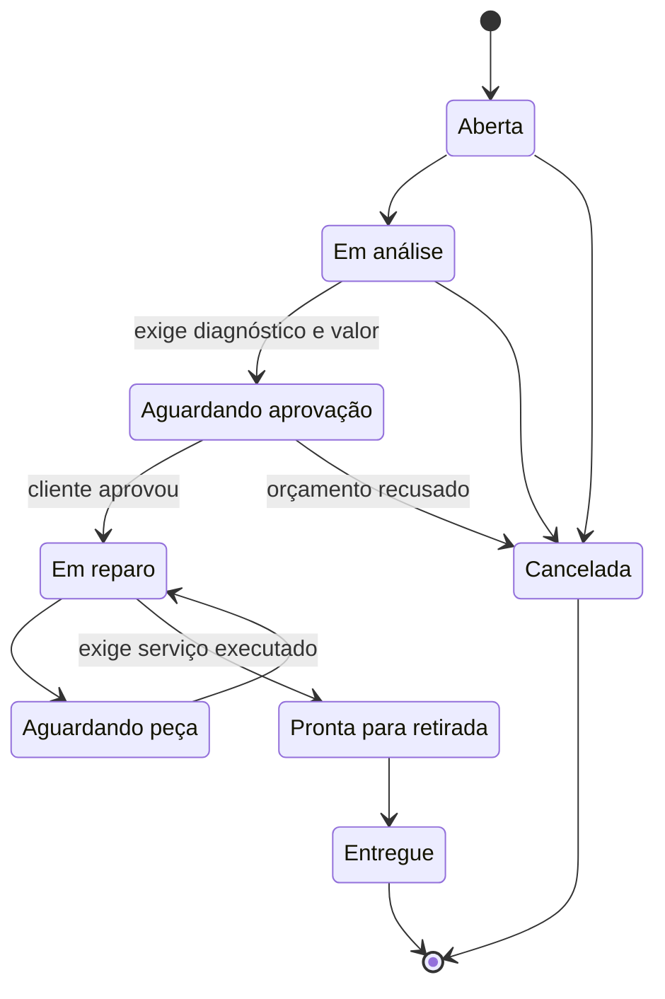
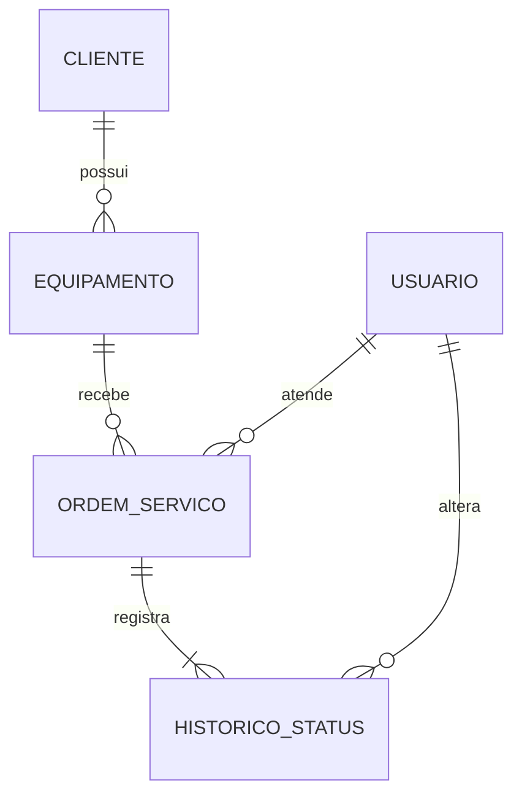

# TecOS — Sistema de Ordens de Serviço

[](https://github.com/GRdS-dot/sistema-ordens-servico/actions/workflows/ci.yml)


Sistema desktop para **assistências técnicas de informática** controlarem os equipamentos que entram para conserto: do recebimento na bancada até a entrega ao cliente.

A ideia veio dos meus 2 anos trabalhando em uma assistência técnica de computadores. Nesse tipo de negócio, o dia a dia é saber quais aparelhos estão esperando peça, quais orçamentos ainda não tiveram resposta e quais clientes já podem ser avisados para buscar o equipamento.


## Funcionalidades

- **Painel** com o resumo do dia: ordens em andamento, prontas para retirada, atrasadas e faturamento dos últimos 30 dias, além de um gráfico por etapa.
- **Ordens de serviço**: abertura, diagnóstico, orçamento, reparo e entrega, com busca por número, cliente ou equipamento e filtro por status.
- **Fluxo de status com regras de negócio**: o sistema só permite avançar para etapas válidas e exige o que cada etapa precisa (veja abaixo).
- **Histórico de cada OS**: toda mudança de status é registrada com data, hora, usuário e observação.
- **Clientes e equipamentos**: cadastro com validação de CPF, telefone e e-mail e busca enquanto digita.
- **Login** com senha protegida por hash (PBKDF2 com salt). A senha nunca é salva em texto puro.
- **Destaque de atrasos**: ordens que passaram da previsão de entrega aparecem em vermelho.

## Telas

| Ordens de serviço | Detalhe da OS com histórico |
|---|---|
|  |  |

| Clientes | Equipamentos |
|---|---|
|  |  |

## Fluxo da ordem de serviço



Regras implementadas em [`OrdemServicoService`](src/main/java/br/com/guilherme/assistencia/service/OrdemServicoService.java) e [`StatusOS`](src/main/java/br/com/guilherme/assistencia/model/StatusOS.java):

- Não é possível pular etapas (por exemplo, de "Aberta" direto para "Entregue").
- Para enviar o orçamento, a OS precisa ter diagnóstico e valor maior que zero.
- Para marcar como pronta, é preciso descrever o serviço executado. A data de conclusão é registrada automaticamente.
- Depois que o reparo começa, a OS não pode mais ser cancelada.
- OS entregue ou cancelada fica bloqueada para edição.
- A mudança de status e o registro no histórico são gravados na **mesma transação**: ou salva tudo, ou nada.

## Tecnologias

| Camada | Tecnologia |
|---|---|
| Linguagem | Java 21 |
| Interface | JavaFX 21 (FXML + CSS) |
| Banco de dados | MySQL 8 (compatível com MariaDB / XAMPP) |
| Acesso a dados | JDBC puro, padrão DAO |
| Build | Maven |
| Testes | JUnit 5 (unitários e de integração com banco) |
| Integração contínua | GitHub Actions (compila e roda os testes com um MySQL real a cada push) |

## Arquitetura

O projeto segue o padrão **MVC** com camadas separadas:

```
src/main/java/br/com/guilherme/assistencia
├── App.java               # inicia o JavaFX e troca as telas
├── model/                 # entidades: Cliente, Equipamento, OrdemServico, StatusOS...
├── dao/                   # acesso ao MySQL (DAO + JDBC): ClienteDAO, OrdemServicoDAO...
├── service/               # regras de negócio (sem dependência de tela ou banco)
├── controller/            # controllers das telas FXML
└── util/                  # validação de CPF, hash de senha, formatação de datas e moeda

src/main/resources/br/com/guilherme/assistencia
├── view/                  # telas em FXML (editáveis no Scene Builder)
└── styles/estilo.css      # visual do sistema
```

- **model** só guarda dados.
- **service** decide o que pode e o que não pode. Por não depender de banco nem de tela, essa camada é testada com testes unitários rápidos.
- **dao** só executa SQL, sempre com `PreparedStatement` (evita SQL injection) e `try-with-resources` (as conexões sempre são fechadas).
- **controller** liga a tela às camadas de baixo e mostra mensagens amigáveis ao usuário.

## Banco de dados



Os scripts ficam em [`database/`](database):

- [`schema.sql`](database/schema.sql) cria o banco, as tabelas e o usuário inicial.
- [`dados-exemplo.sql`](database/dados-exemplo.sql) carrega clientes, equipamentos e ordens de demonstração, com datas relativas ao dia de hoje.

## Como executar

### Pré-requisitos

- JDK 21 ou mais recente
- Maven 3.9 ou mais recente (o NetBeans e o IntelliJ já trazem o Maven)
- MySQL 8 ou MariaDB (por exemplo, pelo [XAMPP](https://www.apachefriends.org/))

### Passo a passo

1. **Clone o repositório**

   ```bash
   git clone https://github.com/GRdS-dot/sistema-ordens-servico.git
   cd sistema-ordens-servico
   ```

2. **Crie o banco.** Execute os scripts no MySQL (pelo phpMyAdmin ou pelo terminal):

   ```bash
   mysql -u root -p < database/schema.sql
   mysql -u root -p < database/dados-exemplo.sql   # opcional: dados de demonstração
   ```

3. **Configure a conexão.** O padrão é `localhost:3306`, usuário `root` e senha vazia, como no XAMPP. Se o seu MySQL for diferente, copie `banco.properties.exemplo` para `banco.properties` e ajuste os dados.

4. **Rode o sistema**

   ```bash
   mvn javafx:run
   ```

   No NetBeans, basta abrir a pasta do projeto e clicar em **Run (F6)**.

5. **Faça login** com o usuário `admin` e a senha `admin123`.

### Testes

```bash
mvn test
```

Os testes de regra de negócio rodam sem banco. Os testes dos DAOs rodam quando a variável `DB_URL` está definida, como acontece no GitHub Actions:

```bash
DB_URL="jdbc:mysql://localhost:3306/assistencia_os" DB_USER=root DB_PASSWORD= mvn test
```

## Próximos passos

- [ ] Gerar o comprovante da OS em PDF para o cliente assinar na entrega
- [ ] Avisar o cliente pelo WhatsApp quando a OS ficar pronta
- [ ] Cadastro de usuários e permissões (atendente × técnico)
- [ ] Controle de estoque de peças vinculado às ordens
- [ ] Versão web com API REST (Spring Boot)

## Autor

**Guilherme Rodrigues da Silva**, estudante de Análise e Desenvolvimento de Sistemas na FATEC São Caetano do Sul

[LinkedIn](https://www.linkedin.com/in/guilherme-rodrigues-da-silva-672a02410/) · [GitHub](https://github.com/GRdS-dot)
